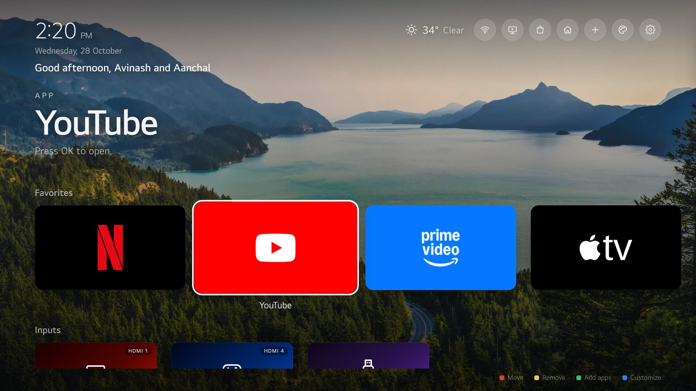
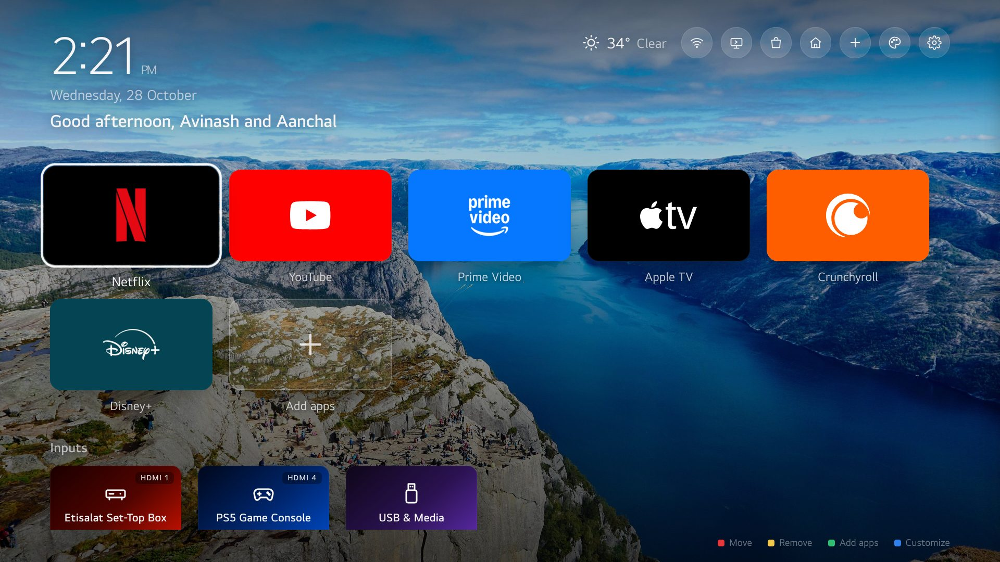
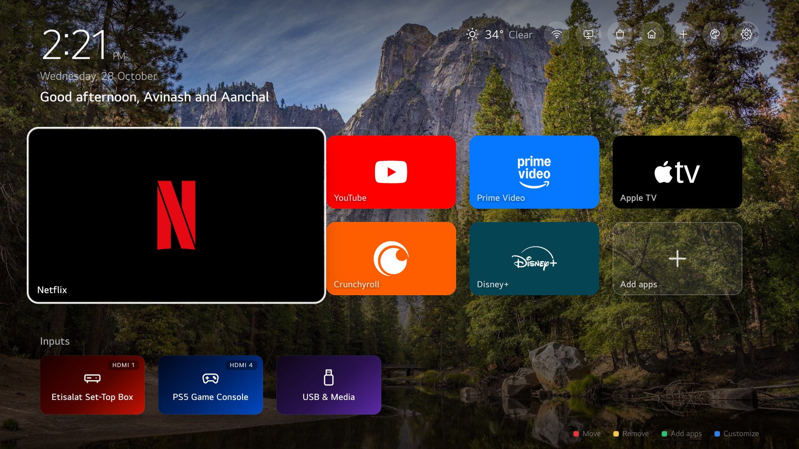
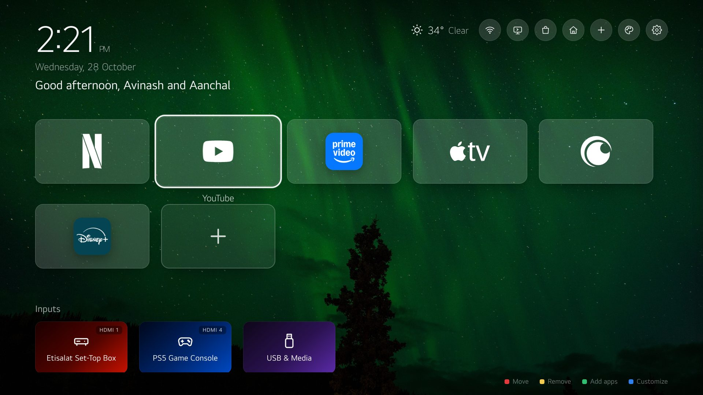
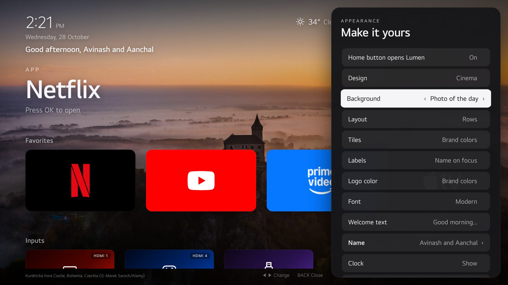
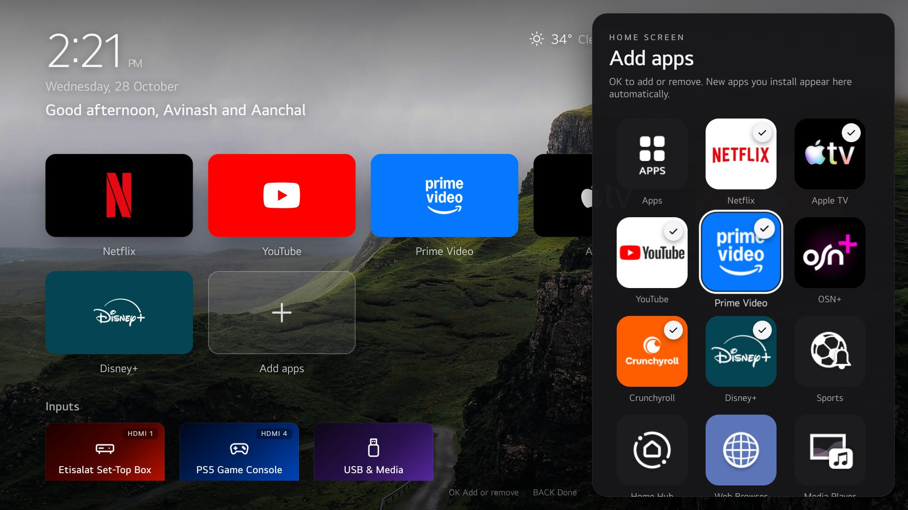
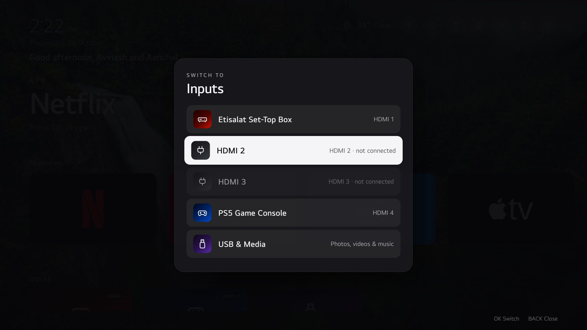

# Lumen — a clean, Apple TV-style home screen for LG webOS TVs

Lumen replaces the cluttered, ad-filled LG home screen with a calm, minimal launcher:
big app tiles with real logos, beautiful 4K photo backgrounds, a clock and weather,
your HDMI devices, and a customization menu. It installs as a **Developer Mode app** and
doesn't modify LG's firmware, so removing it puts the TV back exactly as it was.

> Built and tested on an **LG 55QNED756RB (webOS 25, firmware 33.31.75)**. Other webOS 23–25
> TVs should work; see [Limits](#limits).

## Before and after

| Stock LG home (webOS 25) | Lumen |
| --- | --- |
|  |  |

## Screenshots

All screenshots were taken on the TV itself.

**Cinema layout**: Apple TV-style rows, with a large title for the focused app.


**App icons layout**: a grid of large brand tiles.


**Mosaic layout**: your first favorite as a large tile.


**Minimal design**: glass tiles, white logos, light font.


**Customize ("Make it yours")**: every option changes live behind the panel.


**Add apps**: every installed app with its real icon; ticked apps join Favorites.


**Inputs**: live list of HDMI ports, named as in LG's input menu.


**Screensaver**: 4K photo slideshow with clock, date and weather.


## Features

- **Three layouts and four design presets**: Cinema, Icons, Mosaic and Minimal. You can also
  mix your own: tile style (brand colors, glass or dark), labels, logo color and font.
- **Real app icons.** The installed-app list comes from the TV, so apps you install later
  appear automatically. Netflix, YouTube, Apple TV and Crunchyroll use vector logos that
  stay sharp at 4K.
- **Live inputs.** HDMI devices appear when plugged in, using the names you gave them on the
  TV (game console, set-top box, PC…). There's also a **USB & Media** tile.
- **Top bar**: clock, date, a time-of-day greeting with your name, weather, Wi-Fi status,
  Inputs, the LG Apps store, LG Home, Add apps, Customize and LG Settings.
- **Backgrounds**: Bing's 4K *Photo of the day* (new every day), 12 curated landscapes,
  animated ambient scenes that work offline, or black.
- **Screensaver** after 3, 5 or 10 minutes idle.
- **Home button opens Lumen** (optional): exiting an app or pressing Home brings you back
  to Lumen, including after the TV is turned on.
- **No ads, no tracking, no accounts.**
- **Smooth on TV hardware**: 60 fps navigation, measured on the TV.

## Remote control

| Button | Action |
| --- | --- |
| Arrows / Magic Remote pointer | Move (Up from the tiles reaches the top-bar buttons) |
| OK | Open / select |
| **Red** | On a favorite: move it (◀ ▶, then OK). On an input: pin it to Favorites |
| **Yellow** | Remove the focused favorite |
| **Green** | Add apps |
| **Blue** | Customize (◀ ▶ changes a value, Back closes) |
| Back | Close the open panel |

All other buttons (Home, Settings, mic, volume, Input, Netflix and Prime keys) work as
usual. The LG ThinQ phone app keeps working too.

---

## Install

You need a Windows, macOS or Linux computer on the same network as the TV, with
[Node.js](https://nodejs.org) 22 or newer. The scripts were written and tested on Windows;
`renew:schedule` and `preview` are Windows-only.

### 1. Turn on Developer Mode on the TV

1. On a computer, sign in at <https://webostv.developer.lge.com> with your LG account and
   accept the developer terms. (An account created through Google or Apple sign-in needs
   an LG email and password set first.)
2. On the TV, open **Apps** (LG's store), search for **Developer Mode** and install it.
3. Open Developer Mode, sign in, and turn **Dev Mode Status** on. The TV restarts.
4. Open Developer Mode again, turn **Key Server** on, and note the TV's **IP address** and
   **passphrase**. Keep this app on screen during the next step.

### 2. Install Lumen

```bash
git clone https://github.com/<your-username>/lumen-webos.git && cd lumen-webos
npm install

# register the TV (use your TV's IP)
npx ares-setup-device -a tv -i "host=192.168.1.50" -i "port=9922" -i "username=prisoner" -i "default=true"

# fetch the TV's SSH key; enter the passphrase from the TV (it's case-sensitive)
npx ares-novacom -d tv --getkey
npx ares-setup-device -m tv -i "passphrase=ABC123"

npm run deploy        # builds, installs and opens Lumen
```

When Lumen opens, the TV shows an **Allow** prompt so Lumen can list your apps. Select
**Allow** once.

Then, in the Developer Mode app, turn **Key Server off** again (see [Security](#security)).

### 3. Make it yours

Press **Blue** on the remote to open Customize: design, background, your name for the
greeting, screensaver and so on. To change the defaults for everyone who installs your
copy, edit [app/js/config.js](app/js/config.js):

| Setting | What to change |
| --- | --- |
| `weather` | `place`, `latitude`, `longitude`, `unit` |
| `defaults.name` | Name shown in the greeting (also editable on the TV) |
| `defaultFavorites` | App ids shown on first run |
| `clock24` | `true` for a 24-hour clock |
| `backgrounds` | The background list |

Run `npm run deploy` after editing.

### Keep Developer Mode active

Developer Mode sessions expire (this TV showed 999 h, about 41 days; older TVs show 50 h),
and webOS removes Developer Mode apps when the session runs out. Renew it before then:

```bash
npm run renew              # renew now (TV must be on)
npm run renew:schedule     # Windows: renew every 12 h automatically
```

If it lapses, turn Dev Mode on again and run `npm run deploy`.

---

## How "Home button opens Lumen" works

webOS doesn't let apps replace the Home button, and it closes Developer Mode apps when
another app opens. Lumen ships a small **background service** (`service/`) that keeps
running. It:

1. watches which app is in front, through the TV's local control service;
2. reopens Lumen when LG's home screen appears (Home button, or an app exiting);
3. reopens Lumen when the TV wakes from standby, whatever it woke into;
4. registers a webOS scheduler job that survives restarts, so the service starts again after a
   full power cycle once the network is up.

Lumen's own **LG Home** button opens LG Home for that one visit. Turn the whole feature off
in Customize → **Home button opens Lumen**.

**What you'll see:** LG Home appears briefly before Lumen covers it: about 0.4 s when Lumen
was in the background, longer when coming from a heavy app, which Lumen's splash screen
helps hide. The TV draws LG Home before any app can react, so this can't be removed without
rooting the TV.

## Security

| Area | How it's handled |
| --- | --- |
| TV pairing | The service pairs once (the Allow prompt) with the **minimum permissions**: launch apps, list apps, see the app in front, read power state. It can't change power, volume, inputs or type. |
| Pairing key | Stored only in the service's private folder on the TV (owner-only file). Never in the web page or on your computer. |
| Service access | Every method checks the caller; anything other than Lumen gets `not allowed`. |
| Page content | App names, Wi-Fi names and typed text are escaped or set as plain text. |
| Network | Lumen only downloads public data over HTTPS: weather (Open-Meteo) and photos (Bing, picsum). It sends nothing about you or what you watch. |
| Repo | No keys, tokens or passwords. The webOS CLI keeps the Developer Mode SSH key in your user profile (`~/.ssh/tv_webos`); keep your computer account locked. |

**Developer Mode itself** opens an app debugger (port 9998) and SSH (port 9922, key-only)
on your local network. Anyone on your Wi-Fi could attach the debugger to Lumen; thanks to the
above, they could only open or list apps. Keep **Key Server off**, use WPA2/WPA3 Wi-Fi, and
put guests on a separate network.

## Limits

| | |
| --- | --- |
| LG Home flash | Visible briefly before Lumen covers it (see above). Removing it needs root. |
| "Continue watching" | Netflix, Apple TV and others don't share what you watch with other apps, and webOS 25 has no "now playing" service. Lumen can't show titles. |
| USB drives | webOS doesn't let apps detect USB storage, so **USB & Media** is always shown and opens LG's media player. |
| Other models | The input service, app list and boot job were tested on webOS 25. Older webOS versions may differ. |

## Uninstall

```bash
npm run uninstall          # removes Lumen, its service, its pairing key and settings
npm run renew:unschedule   # if you scheduled renewals
```

Then turn **Dev Mode Status** off in the Developer Mode app (the TV restarts) and uninstall
Developer Mode if you like. Your apps, input names and LG settings are untouched.

---

## For developers

```
app/            the web app (HTML/CSS/vanilla JS, no framework, ~1 s startup)
  js/app.js       layouts, navigation, panels
  js/config.js    defaults (edit this)
  js/backgrounds.js, ambient.js, weather.js, luna.js, logos.js
service/        background service (Node 16 on the TV): default home, pairing, app list
tools/          build, deploy and test helpers
docs/screenshots/
```

| Command | What it does |
| --- | --- |
| `npm run deploy` | Build, install and open on the TV |
| `npm run preview` | Open the UI in a desktop browser (mock data) |
| `npm run inspect` | Chrome DevTools attached to Lumen on the TV |
| `npm run tv:eval -- "expr"` | Run JavaScript inside Lumen on the TV |
| `node tools/tvshot.mjs out.jpg [keys]` | Screenshot Lumen on the TV, optionally pressing keys first |
| `npm run tv:selftest` | Launch every tile and report failures (the TV switches apps) |

To publish your own copy, change the app id `com.avinash.lumen` in `app/appinfo.json`,
`service/` (`package.json`, `services.json`, `service.js`), `app/js/config.js`
(`hiddenApps`) and `app/js/app.js` (service URL).

## Credits

Photos: Bing Photo of the Day (credited on screen) and Unsplash via picsum.photos. Weather:
Open-Meteo. Vector logos: Simple Icons (CC0). App icons come from your own TV. All
trademarks belong to their owners. Lumen is not affiliated with LG, Apple, Netflix, Amazon
or Google.
